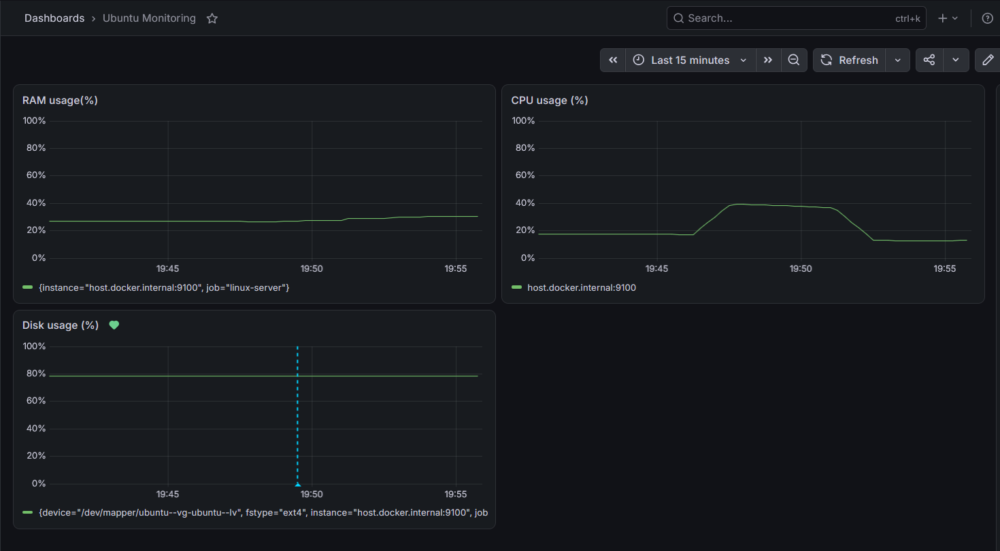
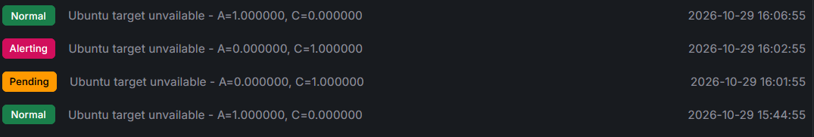
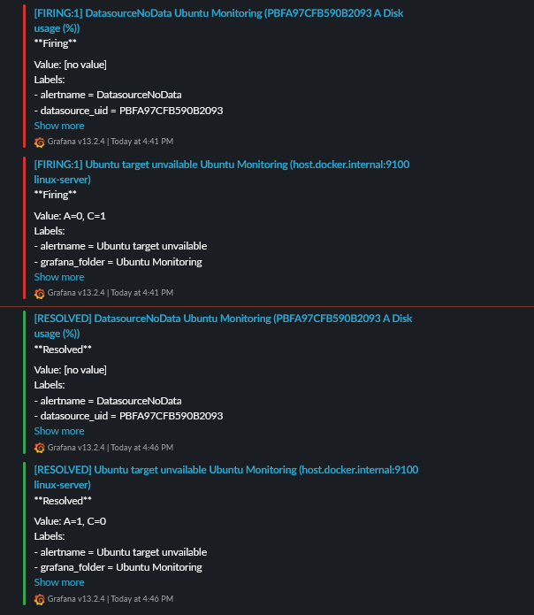

# Netmon — Ubuntu Monitoring Lab

Netmon collects Ubuntu system metrics, displays them in Grafana, and sends Slack notifications when alert conditions fire or recover.

## Architecture

Node Exporter → Prometheus → Grafana → Slack

All three monitoring services run as Docker containers on an Ubuntu VM. Windows provides browser access to Grafana. The VM uses NAT networking.

| Container | Purpose |
| --- | --- |
| `netmon-node-exporter` | Exposes system metrics |
| `netmon-prometheus` | Scrapes and stores metrics |
| `netmon-grafana` | Displays dashboards and evaluates alerts |

## Deployment files and setup

The included `compose.yaml` is intended to run on the Ubuntu VM with Docker Engine and the Compose plugin installed. Node Exporter uses Linux host networking and mounts the host root filesystem. Run the following commands from the project directory on Ubuntu:

```bash
cp -n .env.example .env
nano .env
# Set GRAFANA_ADMIN_PASSWORD and SLACK_WEBHOOK_URL, then save.
docker compose config --quiet
docker compose up -d
docker compose ps
```

Use `sudo` for Docker commands if your Ubuntu account requires it. The administrator password setting initializes a new Grafana data volume; it does not reset an existing administrator password.

Grafana is published on port 3000 and Prometheus on port 9090. Open `http://<VM-IP>:3000` and sign in as `admin` using the configured password. With NAT networking, use a reachable VM address or configure VM port forwarding and use the forwarded host port.

The included Prometheus configuration scrapes itself and `host.docker.internal:9100` under the job name `linux-server`. Grafana provisions a Prometheus data source pointing to `http://prometheus:9090`. Check Prometheus Targets and confirm `linux-server` is UP before expecting system metrics.

### Dashboard, alerts, and Slack provisioning

Grafana loads the Classic JSON dashboard from `dashboards/netmon-dashboard.json`. Its Prometheus references match the provisioned data-source UID `PBFA97CFB590B2093`.

The `grafana/provisioning/alerting/` directory contains both alert rules in `netmon-alerts.yaml` and the Slack contact point in `contact-points.yaml`. Recovery notifications are enabled. The contact point reads its webhook from `SLACK_WEBHOOK_URL`, passed to Grafana by Compose.

Create a Slack incoming webhook for your desired channel and store its URL only in the local `.env` file. Both variables in `.env.example` are required. Never commit the populated `.env`; it is excluded by `.gitignore`.

After changing environment variables, run `docker compose up -d grafana` to recreate the container when necessary. A plain restart does not apply changed container environment settings.

Persisted Grafana and Prometheus data use named Docker volumes. To stop the stack while keeping that data:

```bash
docker compose down
```

On October 30, 2026, the existing Ubuntu deployment displayed all three metric panels, both alert rules and the Slack contact point showed Provisioned, and a contact-point test arrived in Slack. A separate test subsequently verified fresh Grafana and Prometheus storage; see Validation performed.

### If the dashboard shows no data

Check Prometheus Targets at `http://<VM-IP>:9090/targets`. If `linux-server` is down while Node Exporter is running, test connectivity from the host and from Prometheus:

```bash
curl --max-time 5 -s -o /dev/null -w '%{http_code}\n' http://127.0.0.1:9100/metrics
docker exec netmon-prometheus sh -c 'grep host.docker.internal /etc/hosts; wget -T 5 -q -O /dev/null http://host.docker.internal:9100/metrics; echo "Connection result: $?"'
```

On the tested VM, the default `host-gateway` mapping resolved to `172.17.0.1` and timed out. Connecting through `172.18.0.1` succeeded. After using that address, the target returned UP and all three Grafana panels displayed data. The reason the default address timed out has not been established.

The publishing configuration supports an optional `NODE_EXPORTER_HOST_GATEWAY` override in `.env`. For the tested VM:

```dotenv
NODE_EXPORTER_HOST_GATEWAY=172.18.0.1
```

Then run `docker compose up -d prometheus` to apply the changed mapping. Other installations may use a different address: inspect the project's Docker network and test its host gateway before setting an override. Keep the default `host-gateway` when it works. A fixed address may need updating after Docker networks are recreated.

The environment-variable override was verified in the separate test stack using its own host gateway, 172.19.0.1. The original stack used 172.18.0.1. These addresses are specific to the tested networks.

## Dashboard

- RAM usage (%)
- CPU usage (%)
- Root filesystem disk usage (%)

RAM usage query:

```promql
100 - (100 * node_memory_MemAvailable_bytes / node_memory_MemTotal_bytes)
```

CPU usage query:

```promql
100 * (1 - avg by (instance) (rate(node_cpu_seconds_total{mode="idle"}[5m])))
```

Disk usage query:

```promql
100 * (1 - node_filesystem_avail_bytes{mountpoint="/",fstype!~"rootfs|tmpfs|overlay"} / node_filesystem_size_bytes{mountpoint="/",fstype!~"rootfs|tmpfs|overlay"})
```

Disk usage uses space available to ordinary users; filesystem reserved space can affect the percentage.

## Alerts

| Rule | Condition | Pending period | Evaluation |
| --- | --- | --- | --- |
| Disk usage (%) | Above 85% | 5 minutes | Every minute |
| Ubuntu target unavailable | `up{job="linux-server"}` below 1 | 1 minute | Every minute |

Both rules use the `ubuntu-checks` evaluation group and the `Slack monitoring alerts` contact point. Slack notifications are posted to `#monitoring-alerts` in the Netmon workspace using an incoming webhook. Resolved notifications are enabled.

Final notification timing uses the default settings observed in this lab: 30-second group wait, five-minute group interval, and four-hour repeat interval. These timers are separate from the alert pending period. A recovery notification can therefore arrive several minutes after a rule returns to Normal.

## Validation performed

### Fresh-storage provisioning test — October 30, 2026

A separate Compose project, `netmon-clean`, used `compose.clean-test.yaml` with fresh Grafana and Prometheus volumes, Grafana on port 3001, and Prometheus on port 9091. It reused the existing host Node Exporter.

The user verified that the Prometheus target was UP, found the dashboard and provisioned alerting resources in the new Grafana instance, and received a Slack contact-point test notification. The test network's host gateway, `172.19.0.1`, was supplied through `NODE_EXPORTER_HOST_GATEWAY`.

This verifies provisioning into fresh Grafana and Prometheus storage on the existing Ubuntu VM. It does not establish a complete installation on another machine or a fresh Node Exporter deployment. Automatic firing and recovery tests described below were performed on the original stack.

To stop this test stack while retaining its test volumes, run from the test project directory:

```bash
sudo docker compose -p netmon-clean -f compose.clean-test.yaml down
```

### Disk threshold and recovery

The threshold was temporarily lowered below current disk usage, with no pending period, to trigger an alert without filling the filesystem. After receiving the firing message, the threshold was restored to 85% and the pending period to five minutes. Firing and resolved notifications were received during repeated tests.

### Target outage and recovery

Node Exporter was stopped while Prometheus and Grafana remained running:

```bash
sudo docker stop netmon-node-exporter
```

Rule history confirmed Pending → Alerting while `up` was 0. Node Exporter was then restarted:

```bash
sudo docker start netmon-node-exporter
```

The rule returned to Normal with `up` equal to 1. Firing and recovery notifications were received during the final hotspot test. Stopping Node Exporter also caused a separate disk-rule `DatasourceNoData` notification because disk measurements stopped arriving.

## Scope and limitations

- The availability rule detects a failed Prometheus scrape of Node Exporter. It does not identify the underlying cause by itself.
- A complete VM shutdown also stops Prometheus and Grafana. Detecting that outage requires monitoring outside this VM.
- Slack delivery depends on outbound connectivity and should not be treated as guaranteed based on a few successful tests.
- The containers were observed using `latest` image tags. Pinning tested versions would improve reproducibility.

## Project files

- `compose.yaml`: Ubuntu container deployment.
- `prometheus/prometheus.yml`: metric collection targets.
- `dashboards/netmon-dashboard.json`: Classic Grafana dashboard.
- `grafana/provisioning/`: data source, dashboard provider, alert rules, and Slack contact point.
- `.env.example`: placeholders for private deployment settings.
- `images/`: screenshots from the lab.

Original duplicate exports and personal working notes are omitted from this publishing copy.

## Screenshots

Saved screenshots from the lab:

### System metrics dashboard



### Availability rule history



### Slack notifications



## Next improvements

- Verify the complete stack on a second Ubuntu installation, including a fresh Node Exporter deployment.
- Pin container versions after testing them together.
- Repeat firing and recovery tests after a fresh deployment.
- Add an external availability check for the VM.


